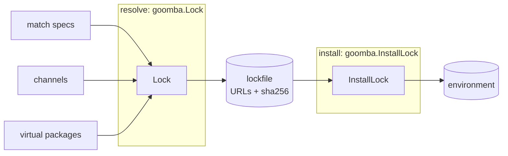

# Architecture

goomba is a conda resolver and installer written in Go. It runs inside the
calling program. To build an environment it downloads channel indexes and
package archives, never an executable. The only programs it runs are:

- the new environment's own Python, to byte-compile (optional);
- `nvidia-smi` and `getconf`, from fixed root-owned system locations (or an
  `nvidia-smi` the caller names, run as given), to detect the machine's
  virtual packages (skipped when the caller supplies them);
- `/usr/bin/codesign` on macOS, to re-sign rewritten Apple Silicon binaries.

## Why it exists

goomba was built for [jumpboot](https://github.com/richinsley/jumpboot),
which used to provision Python by downloading micromamba from GitHub and
running it. That meant three problems:

- **An unchecked executable.** The micromamba binary was downloaded without
  a checksum.
- **Packages chosen at install time.** micromamba resolved against the live
  channel on the user's machine.
- **Host settings changed the result.** micromamba read `~/.condarc`,
  `~/.mambarc` and `MAMBA_*` variables.

goomba replaces that with Go code compiled into the program. It is now a
second jumpboot backend, alongside micromamba.

### What goomba removes

- **The downloaded executable.** The resolver and installer are reviewed Go
  source.
- **Unverified archives.** Every package is checked against its sha256
  before it is unpacked.
- **Runtime choice of packages, when installing from a lockfile.** Only the
  exact archives a reviewed lockfile names are installed.
- **Host settings and install scripts.** The library reads no conda config
  files and no environment variables of its own, and never runs package
  scripts. (Go's TLS stack still uses the system's trusted certificates,
  which `SSL_CERT_FILE` and `SSL_CERT_DIR` can change.)

### What goomba still trusts

- **The packages' contents.** goomba proves you got the bytes the lockfile
  names, not that those bytes are safe.
- **TLS to the channel, when resolving.** Installing from a lockfile relies
  on the hashes alone.
- **The Go toolchain and four modules:** `klauspost/compress` (zstd),
  `vmihailenco/msgpack` with its `vmihailenco/tagparser` (sharded
  indexes), and `golang.org/x/sys` (file locks and `*at` system calls).
- **Nothing pip installs.** goomba never sees pip or PyPI.

## Resolve, then install

A request becomes a lockfile, and a lockfile becomes an environment. The two
halves are independent: installing never needs the resolver or a channel
index, only the archives the lockfile names.



`Create` runs both halves back to back. A program that wants the packages
fixed in review locks at development time, ships or embeds the lockfile,
and calls `InstallLock` at runtime.

## Packages

| Package | Job | Ported from |
| --- | --- | --- |
| `record` | `PackageRecord`, the one type every package shares | rattler `PackageRecord` |
| `spec` | Versions and their order, version specs, build-string globs, match specs, platforms, channel names | libmamba `src/specs` |
| `repodata` | Package records from channels: the sharded index (CEP 16) and the full index, with HTTP caching; shard hashes checked | libmamba `subdir_index.cpp`, `shards.cpp` |
| `virtual` | The machine as virtual packages: `__glibc`, `__linux`, `__osx`, `__archspec`, `__cuda`, ... | libmamba `virtual_packages.cpp` |
| `cdcl` | A generic conflict-learning solver that knows nothing about conda | resolvo |
| `solve` | Conda's rules on top of `cdcl`: specs in, records or an explained conflict out | rattler `rattler_solve` |
| `dag` | Layered order over a multi-dimensional graph, for linking in parallel | pydagger |
| `lock` | The lockfile format; @EXPLICIT import and export; lockfiles from installed environments | conda explicit files |
| `fetch` | Downloads verified by sha256 and size into a content-addressed cache, under file locks | libmamba `package_fetcher.cpp` |
| `archive` | Unpacking `.conda` and `.tar.bz2`, refusing entries that would escape | libmamba `package_handling.cpp` |
| `link` | Installing one unpacked package: files, prefix rewriting, noarch python, entry points, conda-meta | libmamba `link.cpp` |
| `goomba` | `Lock`, `InstallLock`, `Create`, `CheckComplete`, `RemoveIncomplete`: the transaction around everything above | — |
| `cmd/goomba` | The command line | — |

Three internal packages hold the shared safety rules:

- **`internal/safedir`** resolves paths one component at a time. It refuses
  directories that another user could change, and follows symlinks only
  from directories nobody else can change.
- **`internal/netguard`** is the network policy: which URLs a download may
  lead to, and which addresses its connections may reach.
- **`internal/rmtree`** removes a tree through directory handles, never
  following a symlink or entering a mount point.

Ported files name their origin in a header. The BSD-3-Clause notices are in
`NOTICE`.

## The resolver

The resolver pulls records lazily, one package name at a time:

```go
// package repodata
type Source interface {
	Records(ctx context.Context, name string) ([]*record.PackageRecord, error)
}

// package solve
func Solve(ctx context.Context, src repodata.Source, req Request) (*Solution, error)
```

- **`Source` has several implementations:** a sharded channel, a full index,
  `Multi` (several channels with strict priority) and `Memory` (for tests).
  The solver never knows which one it reads.
- **Names are loaded on demand.** The solver asks for a name's candidates
  when a clause first mentions it.
- **The sharded source prefetches.** It loads the shards of the
  dependencies of what it has loaded, in parallel and ahead of the solver,
  as mamba's `shard_traversal.cpp` does. A sharded solve therefore fetches
  the shard index plus the shards of the packages reachable from the
  request, not the whole channel.
- **The python prefilter.** When the specs pin python to one minor series,
  records for other series are dropped while the index loads.

`cdcl` is a port of resolvo: MiniSat-style conflict-driven clause learning
with watched literals, learnt clauses, backjumping and an activity
heuristic. Each candidate record is a variable. The rules become three kinds
of clauses:

- **requires:** A needs one of B1…Bn;
- **forbids:** two records of one name;
- **constrains.**

The port fixes several soundness problems found in resolvo and bounds its
conflict explanations. The [`cdcl` package docs](https://pkg.go.dev/github.com/richinsley/goomba/cdcl)
list each difference.

`solve` adds conda's rules: the candidate order, `constrains`, virtual
packages and channel-qualified specs. When a request is unsolvable, it
returns a readable explanation tree. The same request against the same
records always gives the same solution and the same explanation.

## The installer

`InstallLock` turns a lockfile into an environment in this order. Each step
must succeed before the next starts.

1. **Validate.** The lockfile must be valid and for this platform. Every
   locked package's virtual dependencies must be met.
2. **Plan.** Packages are ordered with `dag`. Dependencies link before their
   dependents, and packages in one layer link in parallel.
3. **Fetch.** Every archive goes into the package cache and is verified
   against its sha256 and size before it becomes visible, then extracted.
   Downloads run in parallel.
4. **Check paths.** The files every package will create are compared, and
   two packages claiming one path stop the install before anything is
   written.
5. **Take the prefix.** goomba creates and locks the prefix, checks it is
   private to the user, and writes the incomplete marker.
6. **Link.** Packages are linked layer by layer. Files are hard linked from
   the cache, or copied when the prefix must be written into them. Then
   every symlink is checked to resolve inside the prefix.
7. **Byte-compile** noarch python packages with the new interpreter
   (optional).
8. **Record** each package in conda-meta, and append to `conda-meta/history`.
9. **The caller's step:** `InstallOptions.BeforeCommit`, if set.
10. **Commit.** goomba sets the final directory mode and removes the marker.

A failure at any step rolls back. [transactions.md](transactions.md) has the
guarantees.

### Link order

Conda dependency graphs have cycles. rattler's test data, for example, has
libzlib → libgcc-ng → _openmp_mutex → llvm-openmp → libzlib. `dag` keeps
three edge sets over the same nodes, and each must stay acyclic:

| Dimension | Edges |
| --- | --- |
| 0 | link order: dependency → dependent |
| 1 | requirement edges moved out of dimension 0 to break a cycle |
| 2 | `constrains` edges |

A cycle is broken by moving a platform package's edge to a noarch package
into dimension 1, so noarch packages link after the platform packages of
their cycle, as rattler does. Any cycle left after that
is broken where a depth-first search in name order closes it. Nothing about
the order depends on the order of the input.

### The package cache

The cache is content-addressed:

- an archive with sha256 S lives at `<PkgsDir>/S/<file name>`;
- its extracted tree lives at `<PkgsDir>/S/pkg`.

A path never holds other bytes later, and two builds that differ only in
their hash never share a path.

- **Extraction reads the verified bytes.** It reads the same file handle
  whose hash was verified, so the archive cannot be swapped between the
  check and the unpacking.
- **The tree is marked last.** After the tree is synced to disk, a
  `.goomba-extracted` marker keyed with an HMAC is written. The key lives in
  the cache and is private to the user.
- **Shared and locked.** Any number of goomba processes can share a cache.
  Each entry is locked while it is downloaded or extracted.

goomba's cache layout differs from micromamba's `pkgs` directory, and the
two must not share a directory.

## Security model

goomba fails closed: a check that cannot be completed stops the install
before the environment changes.

| Risk | Control | Package |
| --- | --- | --- |
| A swapped package manager | No package manager is downloaded or run; goomba is Go source with four pinned modules | — |
| A package altered in transit or on a mirror | sha256 and size checked before unpacking, against the lockfile or the index | `fetch` |
| A swapped shard | Each shard must match the sha256 listed in the shard index, which is fetched over TLS | `repodata` |
| An archive that escapes its directory | Absolute paths, `..`, devices, hard links and symlinks that leave the package are refused, with nothing left on disk | `archive` |
| Code run during install | Link scripts are never run; packages that ship them are refused unless allowed by name | `link` |
| Malicious entry point text | Entry points must parse as `module:function` of Python identifiers before anything is written | `link` |
| A package writing outside the prefix | Destinations are confined to the prefix; symlinks must resolve inside it | `link`, `goomba` |
| Host settings changing the result | The library reads no conda config files and no environment variables of its own; everything comes through options | all |
| Requests aimed at internal services | https only; public hosts may not lead to private addresses, checked at dial time | `internal/netguard` |
| Another user changing the cache or prefix | Caches and prefixes, and every directory above them, must be unchangeable by other users | `internal/safedir`, `fetch`, `repodata` |
| Partial or concurrent installs | A file lock on the prefix and on each cache entry; the incomplete marker; rollback | `goomba`, `fetch` |
| Hostile text reaching a terminal | Control and bidirectional characters from channels and lockfiles are escaped; URL credentials are never printed | `solve`, `cmd/goomba` |

Each package's documentation lists its own remaining risks. Those of the
transaction are in [transactions.md](transactions.md).

## Testing

- **Ported cases.** Upstream test cases from libmamba, resolvo, rattler and
  pydagger are ported as table-driven tests, each table naming its source
  file.
- **Differential tests against micromamba 2.2.0:**
  - solving the same requests against the same frozen index;
  - installing the same explicit set and comparing the trees: paths, modes,
    symlink targets, contents after normalising the install path, and
    conda-meta fields.
- **Live tests** create Python 3.9 to 3.13 environments and scientific and
  documentation stacks from current conda-forge, and compare a current
  environment with micromamba's.
- **Fuzzing.** Every parser has a Go fuzz target.
- **Hostile-input fixtures.** Archives, indexes and lockfiles designed to
  escape, exhaust or confuse each package.
- **Adversarial review.** Every work package was reviewed by a separate
  reviewer whose job was to break it.

Unit tests run offline. Tests that need reference material or the network
read the `GOOMBA_*` variables described in `AGENTS.md` and skip when those
are unset.
